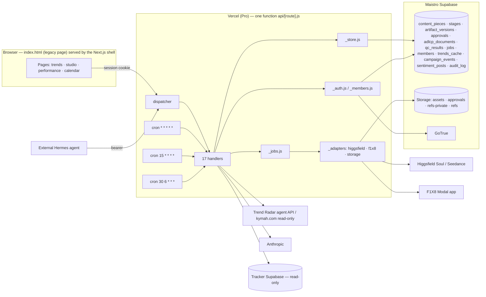
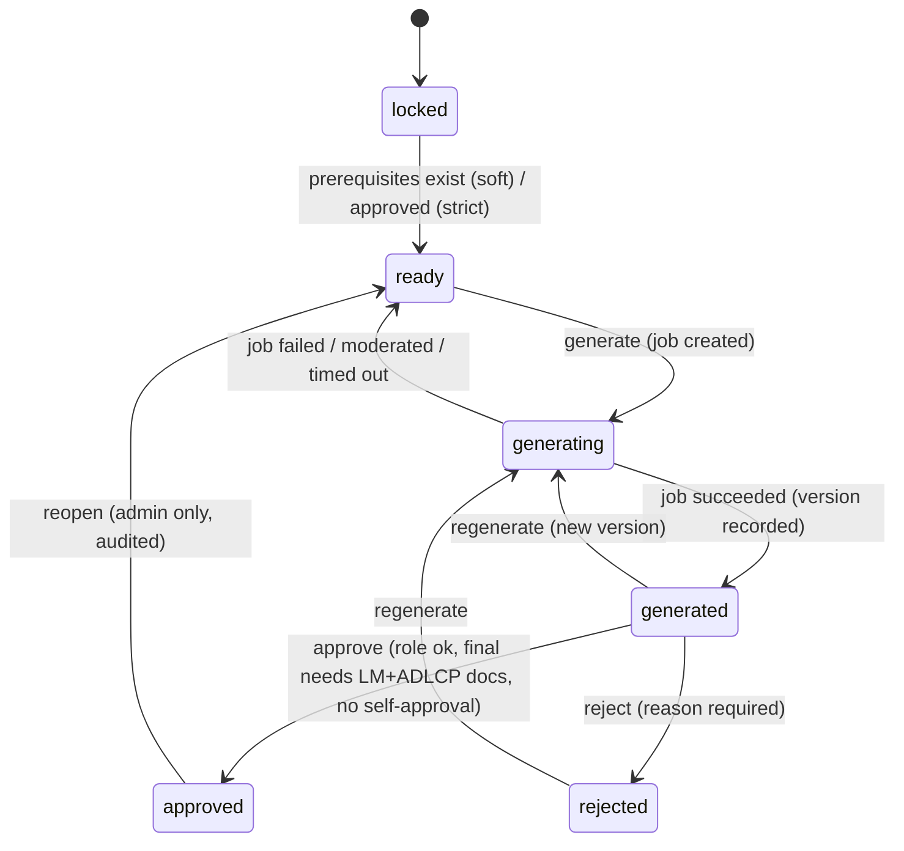

# MAISTRO — Architecture as it runs today

**Revision 2 — 2026-10-21, after milestones M0–M4 of the rebuild.** Revision 1 (the pre-rebuild reconnaissance, same date, commit `ce4a776`) is in git history; AUDIT.md's finding ids refer to that revision's line numbers. This revision describes the system that is live at https://www.ma1stro.com now, with file paths and line numbers from the current tree (branch `rebuild/phase-0-recon`, fast-forwarded into `main`).

Everything below was read from the code or observed with real requests; where something could not be exercised (paid generation, a member sign-in) it says so.

---

## 1. Inventory

### 1.1 What is deployed

| Item | Value |
|---|---|
| Live URL | https://www.ma1stro.com (alias of Vercel project `maistro-demo`, team `mohamedymay7-3982s-projects`) |
| Plan | **Pro** since 2026-10-21 (minute-level crons, 800 s max duration available; we pin 300 s) |
| Deploy path | `cd demo-ui && vercel deploy --prod --yes` from the working tree (CLI). The repo is **not** git-connected yet: the dashboard's Root Directory must be set to `demo-ui` first (owner step, ADR-009). Previews are behind Vercel Authentication (`vercel curl` to probe). |
| Framework | Next.js 15.5.28 shell (`demo-ui/app/`, `next.config.ts`) whose only job today is to serve the legacy single-file page at `/` (rewrite to `public/legacy/index.html`, copied in by `scripts/sync-legacy.mjs` at prebuild) and set security headers |
| Functions | **One** Vercel serverless function, `api/[route].js`, dispatching 17 routes to `api/_handlers/*.js` (the Hobby-era 12-function cap forced the consolidation; it stays because it is simpler) |
| Crons (`vercel.json`) | `/api/jobs` every minute (jobs tick), `/api/trends` at :15 hourly (board refresh), `/api/track` 06:30 UTC daily (performance snapshot) — all authenticated by `CRON_SECRET` |
| Database | Maistro's own Supabase project `lugdbyyonssjracbxqyp` (ap-northeast-1): tables from `db/migrations/001–007`, applied with `node db/migrate.mjs` (`schema_migrations` tracks them); private Storage buckets `assets`, `approvals`, `refs-private`; public bucket `refs` (reference photos, pre-dates ADR-006) |
| Tracker database | The Consumer Sentiment Tracker's Supabase (separate project), **read-only** from Maistro (`TRACK_SUPABASE_URL/KEY`) |
| CI | `.github/workflows/demo-ui.yml`: `npm run check` (node --check of every function), `npm run typecheck`, `npm test` (99 tests, fixtures only), `npm run build` |

### 1.2 Dependencies (`demo-ui/package.json`)

Runtime: `next 15.5.28`, `react 19.1.1`, `react-dom 19.1.1`, `@anthropic-ai/sdk ^0.70.0`, `@higgsfield/client ^0.2.6`. Dev: `typescript 5.9.3`, `pg 8.16.3` (migrations only), `@types/*`. Lockfile committed. Node ≥ 22 (24.16.0 locally and in CI). No zod yet: request validation is the hand-rolled `api/_schemas.js` (ADR-010 allows this until the Next.js server layer brings zod).

### 1.3 Environment variables (names only; values live in Vercel)

| Name | Used by | Required |
|---|---|---|
| `ANTHROPIC_API_KEY` | trends curation, hermes, director | yes |
| `HF_CREDENTIALS` (`key-id:key-secret`) | Higgsfield adapter | yes |
| `SUPABASE_URL`, `SUPABASE_SERVICE_ROLE_KEY` | every store, storage and auth call (server only) | yes |
| `NEXT_PUBLIC_SUPABASE_ANON_KEY` (also `SUPABASE_ANON_KEY`) | GoTrue token verification and magic-link requests (server-side; never sent to the page since `cd8e9e4`) | yes |
| `MAISTRO_DATABASE_URL` | `db/migrate.mjs` only (session pooler, port 5432) | for migrations |
| `TRACK_SUPABASE_URL`, `TRACK_SUPABASE_KEY` | `/api/track` | yes |
| `MAISTRO_INGEST_KEY` | `/api/ingest`, `/api/sentiment` POST, `/api/track?store=1` | yes |
| `CRON_SECRET` | cron detection on `/api/jobs`, `/api/trends`, `/api/track` | yes |
| `MAISTRO_SESSION_SECRET` | HMAC of the session cookie | yes |
| `MAISTRO_APP_PASSWORD` | interim shared-password login; unset to retire it | optional |
| `MAISTRO_ADMIN_EMAILS` | bootstrap admins on first magic-link sign-in | optional (set) |
| `MAISTRO_REQUIRE_MEMBER` (`1`) | `/api/decisions` refuses password sessions | optional (unset) |
| `TRENDRADAR_AGENT_KEY`, `TRENDRADAR_BASE_URL` | Trend Radar agent API | yes / default |
| `MAISTRO_F1X8_BASE_URL`, `QC_ASSET_HOSTS` | F1X8 base, extra allowed media hosts | optional |

`GET /api/health` reports which required names are present (never values) plus the behaviour switches.

### 1.4 External calls (every outbound HTTP request, with the bound on each)

| Target | From | Timeout / retries |
|---|---|---|
| Trend Radar agent API `GET {TRENDRADAR_BASE_URL}/api/agent/trends?limit=200` (bearer) | `_handlers/trends.js:74` | 20 s, 1 retry |
| kymah.com page payload (fallback scrape, read-only; never triggers collection) | `trends.js:154` | 20 s, 1 retry |
| Anthropic Messages API (`claude-opus-4-8`) | trends curation (once per board refresh), hermes (per stage), director (per generation) | SDK timeout 45 s (curation) / 120 s client abort (hermes) |
| Higgsfield `api.higgsfield.ai` (`/v1/text2image/soul` with a reference; SDK `subscribe` for Soul v2 / Seedance; `/requests/{id}/status`, `/v1/job-sets/{id}`) | `_adapters/higgsfield.js` | 30 s submit, 10 s status, 1 retry on status |
| F1X8 Modal app (`/api/analyze/{image,video}/submit` multipart, `/api/job/{id}`) | `_adapters/f1x8.js` | 60 s asset download, 120 s submit, 20 s status |
| Maistro Supabase PostgREST (`/rest/v1/*`), Storage (`/storage/v1/*`), GoTrue (`/auth/v1/*`) | `_supabase.js`, `_adapters/storage.js`, `_members.js`, `_handlers/upload.js` | 10–60 s |
| Tracker Supabase PostgREST | `_handlers/track.js:229` | 30 s, 4 attempts (statement-timeout warm-up) |
| Google translate `translate.googleapis.com` (gtx) | `_handlers/translate.js` | 10 s, 1 retry |

Every call goes through `api/_http.js fetchT()` (hard `AbortSignal.timeout`, bounded retries on 429/5xx) except the two SDK calls, which are raced against a timer.

### 1.5 Repo layout relevant to the live product

```
demo-ui/
  index.html                 the whole UI (3565 lines; see §3)
  app/, next.config.ts       Next.js shell (rewrite + headers)
  api/[route].js             the single function: route → handler
  api/_handlers/*.js         17 handlers (trends, hermes, director, higgsfield, qc-f1x8, ingest,
                             projects, sentiment, track, upload, translate, login, health,
                             pieces, decisions, members, jobs)
  api/_auth.js _members.js   sessions (password + member), roles, GoTrue, invitations
  api/_store.js _jobs.js     campaign store (pieces/stages/versions/approvals/documents), job service
  api/_adapters/*.js         higgsfield, f1x8 (incl. SSRF allow-list), storage (copy-in, signed URLs)
  api/_schemas.js _supabase.js _http.js _brand.js
  src/domain/stages.js(.d.ts) the stage state machine (pure; shared by functions and the Next.js layer)
  db/migrations/001–007.sql  members, content_pieces+stages, artifact_versions+approvals+adlcp_documents+qc_results,
                             jobs, audit_log triggers, buckets, trends_cache; db/migrate.mjs
  tests/                     node:test suites (api/, page/, domain/), fixtures/, fake-postgrest.js
  API.md                     every route's contract
legacy/engine/               the September Python/LangGraph scaffold — not used (owner decision)
docs/adr/001–011, ARCHITECTURE_TARGET.md, MIGRATION_PLAN.md, AUDIT.md, BASELINES.md, REBUILD_LOG.md, PROGRESS.md
```

---

## 2. Where state lives

| State | Lives in | Notes |
|---|---|---|
| Content pieces, their 8 stages and states | `content_pieces`, `stages` (Maistro Supabase) | written through `/api/pieces` (legacy page write-through), `/api/ingest` (external Hermes), `/api/jobs` (completions); `legacy_id` keeps the browser id (`gen-…`, `ext-…`) |
| Artifact versions | `artifact_versions` (append-only; `unique(stage_id, version)`) | `produced_by`, `job_id`, `generated_by`; the stage's `current_version_id` points at the latest |
| Approvals and rejections | `approvals` (immutable; one `approved` per version by index) | `decided_by` (member) or null under a password session; `name_as_signed`, `role_as_signed`, reason |
| Line-manager and ADLCP documents | private bucket `approvals` + `adlcp_documents` (path, sha-256, size, uploader) | bound to the final's version at approval time |
| QC results | `qc_results` against the analysed version; heatmaps in bucket `assets` | written by the job service |
| Long-running work | `jobs` (state, attempts, next_poll_at, provider_ref, result, error) | the one-minute tick and page reads advance it |
| Generated media | provider URL on the artifact **and** a copy in bucket `assets` with sha-256 (`assetPath`) | the legacy page still renders the provider URL; new pages will sign `assetPath` |
| Trend board | `trends_cache` (raw + curated, `fetched_at`, last error) | refreshed hourly by cron and on read when older than an hour |
| External Hermes pushes | `campaign_events` (append-only event log, read by `/api/projects`) **and** the store | both are written; a push onto an approved stage is refused before either |
| Performance snapshots | `sentiment_posts` (daily cron store) + live reads of the tracker DB | merged in the page |
| Members and roles | `members` (role, active) keyed by the Supabase Auth user id | invited through GoTrue |
| Audit trail | `audit_log` (trigger on pieces, stages, versions, approvals, documents, jobs) | actor from the JWT claim when present — null for service-role writes today (open item) |
| **Browser only** | `localStorage maistro-gen-v2` (projects + deliverables cache), `maistro-legacy-providers` (rollback flag), in-flight job ids per project (`p.jobs`) | a cache: on login the page reads the server's pieces back and the server wins; losing it loses nothing recorded |

The pre-rebuild Critical ("approvals and ADLCP live only in the browser") is closed for the data; what remains browser-side is the **order** of stages on the legacy page (soft prerequisites, §6.7) and the rendering of provider URLs.

---

## 3. `index.html` structure

### 3.1 Shell and routing

- `<body class="locked">` until `doLogin()` (`index.html:1061`). Login overlay `#login` with password **and** "Email me a sign-in link" (member sign-in, `AUTH` state `:996`); a returning magic link (`#access_token=…`) is exchanged at boot (`authFromHash`, `exchangeToken`).
- Hash router `routes = {'':rHome, trends, studio, calendar, performance}` (`:1172`); every state change re-renders `#view` from a template-string function. No components, no diffing (unchanged; M5–M7 replace pages with React).
- Global state objects: `STATE`, `TRENDS`, `PROJECTS`, `DELIVS`, `CAL` (simulated calendar, kept on purpose), `BOT`, `GEN`, `QCRUN`/`QCHEAT`, `SENTI`, `LIVE`, `PLAN`, `AUTH`, `SYNC`.
- `esc()` escapes `& < > " '`; every interpolated campaign/deliverable/approval field passes through it; comments and captions render with `dir="auto"`; all dates are Asia/Dubai with a GST suffix (`fmtStamp` etc.).

### 3.2 Pages

| Route | What it does now |
|---|---|
| `#/` | Landing (ASCII-dithered smoke), "ENTER THE PLATFORM" |
| `#/trends` | Board from `/api/trends` with `LIVE · TRENDRADAR · BOARD <time>` header, BOARD EMPTY / FEED UNREACHABLE / STALE states; per card: Dispatch to Hermes, Build in Studio; clips, sound clearance |
| `#/studio` | Pathways, campaign tabs, the 7-stage pipeline, stage artifacts (`stageArtifact`), the **Production Center** (approve/reject with role select, LM + ADLCP uploads on final), copilot, members panel for admins |
| `#/calendar` | Simulated month (no Sprinklr access; placeholder by owner decision) |
| `#/performance` | KPI deck, tracker-style filters, post cards, critical alerts (cross-post twin fold), week-on-week health, DATA AS OF + STALE pill |

### 3.3 Client ↔ API map (every `fetch` in the page)

| Call | Purpose |
|---|---|
| `GET /api/login`, `POST {password}` / `{email}` / `{access_token}`, `DELETE` | session, magic link, sign-out |
| `GET /api/trends` | board (edge-cached 15 min; served from `trends_cache`) |
| `GET /api/projects` every 15 s | external Hermes campaigns (from `campaign_events`) |
| `GET /api/pieces` on login; `POST /api/pieces` | read-through of the store; write-through of every artifact the page produces (`syncStage`) |
| `POST /api/decisions` | approve / reject (server decides) |
| `POST /api/hermes` | plan/brief/qc text stages and the dispatch chain |
| `POST /api/director` | prompt crafting for image/video stages |
| `POST /api/jobs`, `GET /api/jobs?id=`, `?asset=` | renders and F1X8 checks (M3 path, default) |
| `POST /api/higgsfield`, `GET ?id=`; `POST /api/qc-f1x8`, `GET ?job=` | the direct path (rollback flag `maistro-legacy-providers=1`) |
| `POST /api/upload` (photo / `kind=document`), `GET ?path=` | reference photos; LM/ADLCP documents; signed read |
| `GET/POST/PATCH /api/members` | admin: list, invite, role, deactivate |
| `POST /api/translate` | comment translation |
| `GET /api/track?days=14` then `60`, `GET /api/sentiment` | performance data |

---

## 4. Endpoints — behaviour and shapes

`demo-ui/API.md` is the contract for all 17 routes (auth per route, bodies, responses, error codes) and is kept current with every change; it is not repeated here. Summary of the auth model:

- Public: `health`, `trends`, `projects`, `sentiment` GET, `track` GET.
- Ingest-key bearer: `ingest`, `sentiment` POST, `track?store=1`.
- Cron (`CRON_SECRET`): `jobs` tick, `trends` refresh, `track` snapshot.
- Session cookie (password or member): `hermes`, `director`, `higgsfield`, `qc-f1x8`, `upload`, `translate`, `pieces`, `decisions`, `jobs`.
- Admin member session: `members`.
- Validation at the door: `api/_schemas.js` for ingest artifacts (per stage), hermes and director bodies; `422`/`400` with a `problems[]` list.

---

## 5. Running it locally — exact steps and what fails

```
cd D:\MAISTRO\demo-ui
npm ci
npm test            # 99 tests on recorded fixtures and an in-memory PostgREST; no network, no paid APIs, never touches kymah
npm run check && npm run typecheck && npm run build
vercel dev          # serves the page; functions answer 503 for every integration whose secret is not set locally
```

Observed: without the production secrets no workflow runs end to end locally (every integration fails closed with a 503 naming the missing variable). The test suite is the way to exercise logic locally; `tests/fake-postgrest.js` stands in for the database. `vercel dev` did not load `.env.local` in the rev-1 run; not re-investigated since the suite replaced that need.

Migrations: `MAISTRO_DATABASE_URL=… node db/migrate.mjs --status | (apply)`; the session-pooler string handles DDL.

---

## 6. Workflows as they actually run

### 6.1 Trend intake
Hourly cron (or a read older than an hour) → Trend Radar agent API (fallback: kymah page payload) → normalised (`normalizeAgent`) → Claude curation once per refresh (rules fallback) → `trends_cache` → `/api/trends` serves the row; on a failed refresh the cached board is served with `cache.stale:true`. Collection is never triggered (GET of the published board only).

### 6.2 Dispatch to Hermes (built-in chain)
`dispatchTrend` → `/api/hermes` per stage (plan, mood, thumb, brief, board, final, qc) → each artifact written through `/api/pieces` (origin `hermes_dispatch`) → deliverables pending in the Production Center. The qc stage is an honest pre-flight estimate (`simulated:true`, no invented reviewer) until ADR-007's re-base on real F1X8 (M5).

### 6.3 External Hermes push
`POST /api/ingest` (bearer) → schema validation → store write (`recordVersion`, origin `external_hermes`; `409 approved_immutable` on an approved stage) → `campaign_events` → `/api/projects` → page.

### 6.4 Content Studio
Plan via hermes → stage boxes; image/video stages: `/api/director` (prompt) → **`POST /api/jobs`** (stage set `generating`; soft prerequisites checked; submit inline) → page polls `GET /api/jobs?id=` every 10 s; the tick polls the provider every 20–90 s; on completion the asset is copied into `assets`, the version recorded (`produced_by`, `job_id`), the stage `generated`; the page attaches the artifact with the server's version. A failed/moderated render returns the stage to `ready`. Text stages (brief) still go through hermes directly and are written through `/api/pieces`.

### 6.5 Quality check (real F1X8)
`qcRunAll` → one `f1x8_image|video` job per generated visual → the tick/page polls → result stored in `qc_results` against the analysed version, heatmap in `assets` → page composes the QC artifact (avg) and writes it through `/api/pieces` (`produced_by f1x8`).

### 6.6 Final = "implement F1X8's fixes"
Director stage `revise` with the draft prompt + QC fixes → `higgsfield_video` job → artifact `qcRevised:true`. **Still not verified by a re-run** (AUDIT B-03 open; the UI suggests re-running QC).

### 6.7 Approvals and the ADLCP gate
Approve → `POST /api/decisions` → `src/domain/stages.js transition()` decides: only a `generated` stage; reviewer+ for ordinary stages; final needs **both** stored documents (path + sha-256 verified) and a line-manager / ADLCP-approver / admin; no self-approval; one `approved` per version (database index); rejection needs a reason; reopen is admin-only. Under a member session the role comes from the `members` row (re-read on every call); under the interim password session it is the signer's claim (`MAISTRO_REQUIRE_MEMBER=1` closes that). **Stage order** on the legacy page is soft (prerequisites must exist), by design until the new pages (strict mode exists in the domain).

### 6.8 Calendar / Sprinklr
Placeholder (simulated data) — no Sprinklr access. ADR-008 plans manual/export mode (M8).

### 6.9 Performance
`/api/sentiment` + `/api/track?days=14` in parallel → `sentiCompose` paints → `days=60` widens in the background; twin comments collapsed per post (server + client) and across posts in the alerts/drill-downs; data age pill (> 48 h STALE); Gulf time everywhere.

---

## 7. Diagrams

### 7.1 System architecture



### 7.2 Data flow for one Studio render (M3)

```mermaid
sequenceDiagram
  participant P as Page
  participant J as /api/jobs
  participant S as _store / domain
  participant HF as Higgsfield
  participant SB as Storage
  participant T as tick (cron)
  P->>J: POST {pieceId, stage, kind, payload}
  J->>S: prerequisitesMet? transition(generate) → stage generating
  J->>HF: submit (bounded)
  J-->>P: {job: running}
  loop every 10 s
    P->>J: GET ?id=
    J->>HF: status (only when next_poll_at is due; conditional claim)
  end
  T->>J: GET (CRON_SECRET) — advances due rows even with the tab closed
  HF-->>J: completed (url)
  J->>SB: copy-in (sha-256) → assets/pieces/…
  J->>S: recordVersion(produced_by, job_id) → stage generated
  J-->>P: {job: succeeded, result.artifact, version}
```

### 7.3 Content-piece stage lifecycle (as enforced in `src/domain/stages.js`)



---

## 8. Timeouts and runtime limits

- The single function is pinned to `maxDuration: 300` (`vercel.json`); no handler waits on a provider beyond one bounded call (§1.4). The tick has a 50 s budget per run.
- Edge caching: `/api/trends` 15 min (2 min when stale), `/api/track` 10 min, `/api/translate` 1 day; everything else `no-store`.
- Request bodies: Vercel's 4.5 MB cap bounds uploads (documents ≤ 3 MB, photos ≤ 4 MB after client downscale); `/api/pieces` artifacts ≤ 256 KB; ingest artifacts ≤ 64 KB.
- Database: the tracker DB's 8 s statement timeout is handled by windowed reads and retries; Maistro's own queries are small keyed reads/writes.

---

## 9. Assumptions and open questions (tracked in REBUILD_LOG.md)

- Member sign-in is unexercised live until the owner adds `https://www.ma1stro.com/**` to Supabase Auth's redirect allow-list and signs in once (closes M2's done-when).
- A render through the job path is unexercised live (needs a session and spends Higgsfield credit); the first owner generation is the live check.
- `audit_log.actor` is null for service-role writes (the triggers read the JWT claim); carrying the member id into the write path is open.
- The legacy page renders provider URLs; their retention at Higgsfield is unknown (copies exist in `assets`; new pages will sign them).
- `final = fixes implemented` is still unverified (B-03); `vercel dev` env loading not re-checked; repo not git-connected (previews from branches) — owner step.
