# MAISTRO — Architecture as it actually is (Phase 0 reconnaissance)

Date: 2026-10-21 · Branch: `rebuild/phase-0-recon` · Author: tech lead (Claude) · Status: evidence-only, no code changed.

Everything below was verified by reading the code, running it locally, and probing the live endpoints with read-only or validation-only requests. No paid API was exercised, no write endpoint was called with real data, and kymah's collection was never triggered (only its public homepage HTML was fetched, exactly as `/api/trends` does). Line references are to `demo-ui/index.html` unless a file is named.

---

## 1. Inventory

### 1.1 What is deployed

| Item | Value | Evidence |
|---|---|---|
| Live product | https://www.ma1stro.com (aliases: ma1stro.com, maistro-demo.vercel.app) | `vercel inspect` 2026-10-21 |
| Vercel project | `maistro-demo`, team `mohamedymay7-3982s-projects`, root directory `.` of `demo-ui/`, framework preset "Other", Node.js 24.x | `vercel project inspect maistro-demo` |
| Deploy method | `vercel deploy --prod --yes` from `D:\MAISTRO\demo-ui`, CLI only. The GitHub repo is NOT connected to Vercel for this project (every deployment in `vercel ls` is a CLI upload) | `vercel ls` |
| Region | Functions built for `iad1` | `vercel inspect` |
| Serverless functions | 12 Node functions in `demo-ui/api/` (bundle sizes: higgsfield 186 KB, director 80 KB, hermes 80 KB, rest < 20 KB) | `vercel inspect` |
| Static | `index.html` (3,112 lines / 275 KB), `assets/landing-smoke.png` (528 KB) | `wc` |
| Cron | `30 6 * * *` UTC → `GET /api/track` (daily performance snapshot) | `demo-ui/vercel.json` |
| Function timeouts | `api/hermes.js` 120 s, `api/track.js` 300 s. **All other functions use the Vercel account default — not pinned in config** | `demo-ui/vercel.json` |

### 1.2 Dependencies (`demo-ui/package.json`)

| Package | Declared | Used by |
|---|---|---|
| `@anthropic-ai/sdk` | `^0.70.0` | `api/trends.js`, `api/hermes.js`, `api/director.js` |
| `@higgsfield/client` | `^0.2.6` | `api/higgsfield.js` (v2 client, only for non-reference generations) |

No lockfile is committed (`package-lock.json` is git-ignored at repo root), so **builds are not reproducible** — Vercel resolves `^` ranges at build time. `node_modules` on disk also contains `axios`, `form-data`, `https-proxy-agent` etc. as transitive deps of the two packages. No dev dependencies, no test runner, no linter, no type checker. The only tests are hand-written Node scripts (`demo-ui/.smoke-test.js`, 67 checks, DOM-stub eval of the page script).

Front-end: zero dependencies. Fonts and everything else are inline. `demo-ui/components/ui/*.tsx` are **reference copies of 21st.dev components, not compiled or served** — design notes only.

### 1.3 Environment variables (names only; values never read)

| Variable | Read in | Purpose | Present locally? |
|---|---|---|---|
| `ANTHROPIC_API_KEY` | trends, hermes, director | Claude Opus 4.8 calls | no |
| `HF_CREDENTIALS` (`key-id:key-secret`) | higgsfield | Soul / Seedance | yes (`.env.local`) |
| `MAISTRO_INGEST_KEY` | ingest, sentiment (POST), track (`?store=1`) | Bearer for external writers | no |
| `SUPABASE_URL`, `SUPABASE_SERVICE_ROLE_KEY` | `_supabase.js` (ingest, projects, sentiment, track store), upload | Maistro's own Supabase: tables `campaign_events`, `sentiment_posts`, storage bucket `refs` | no |
| `TRACK_SUPABASE_URL`, `TRACK_SUPABASE_KEY` | track | The **tracker's** Supabase (SamsungSentiment), read directly | no |
| `MAISTRO_F1X8_BASE_URL` | qc-f1x8 | Optional override; defaults to the Modal URL hard-coded in the file | no |

`vercel env pull` is blocked for the agent session, so local runs of any function needing these return 503 (documented in §5).

### 1.4 External calls (every outbound HTTP request the platform makes)

| Target | From | Method | Notes |
|---|---|---|---|
| `https://www.kymah.com/` | `api/trends.js:187` | GET homepage HTML | Read-only scrape of the Next.js flight payload. Nothing here can trigger kymah's collection: it is a plain GET of the public page with a browser-like UA. |
| `api.anthropic.com` (via SDK) | trends:125, hermes:149, director:160 | POST messages | Model `claude-opus-4-8`, adaptive thinking, JSON-schema structured output. trends has a 45 s client timeout; hermes/director have none (rely on function timeout). |
| `https://api.higgsfield.ai` | higgsfield:34,44,72,101 | POST submit, GET status | v2 `requests/{id}/status`; v1 `text2image/soul` + `job-sets/{id}` when a reference image is attached. |
| `https://mohamedymay7--fixation-api-fastapi-app.modal.run` | qc-f1x8:27,55 | POST multipart submit, GET job | No auth on the backend. Asset is downloaded server-side first (`fetch(assetUrl)` line 41) — **SSRF surface** (any https URL). |
| Maistro Supabase (`SUPABASE_URL`) | `_supabase.js`, upload | PostgREST insert/select, Storage upload | Service-role key, bypasses RLS. |
| Tracker Supabase (`TRACK_SUPABASE_URL`) | track:219 | PostgREST select, keyset paging | 8 s statement timeout on that DB; retries 4× on 57014. |
| `https://translate.googleapis.com/translate_a/single?client=gtx` | translate:17 | GET | Unofficial free endpoint, no SLA. |
| `fetch(assetUrl)` | qc-f1x8:41 | GET any https URL | See SSRF note. |

### 1.5 Repo layout relevant to the live product

```
D:\MAISTRO
├─ demo-ui/                 ← THE PRODUCT (Vercel root)
│  ├─ index.html            single-file SPA: CSS 675 lines (10–684), HTML 134 lines (686–819), JS 2,291 lines (820–3110)
│  ├─ api/                  12 serverless functions + 2 helpers (_supabase.js, _brand.js)
│  ├─ assets/landing-smoke.png
│  ├─ components/ui/        design reference .tsx (not built)
│  ├─ scripts/              one-off probes (kymah, soul, seedance, f1x8) — not part of the build
│  ├─ .smoke-test.js, .make-*-preview.js   local harnesses
│  ├─ API.md                public contract for /api/trends, /api/hermes, /api/ingest (partly stale: base URL, "no auth on trends")
│  ├─ supabase-setup.sql    DDL for campaign_events + sentiment_posts
│  └─ vercel.json           timeouts + cron
├─ services/, packages/, db/, langgraph.json, ARCHITECTURE.md, docs/CONTRACTS.md … ← LEGACY Python/LangGraph engine (not the roadmap)
├─ .github/workflows/ci.yml           runs on push to main + PRs: contracts validate, services/core ruff/mypy/pytest, gitleaks — exercises ONLY the legacy engine
├─ .github/workflows/contract-tests.yml  nightly 02:17 UTC, GitHub env "staging" (empty) — legacy
├─ MAISTRO — DemoUI.html    the original static mockup, superseded
└─ docs/                    slides, brand playbook PDF/TXT (used by api/_brand.js as source material, not at runtime)
```

Nothing live depends on `services/`, `packages/` or `db/`: the Vercel build root is `demo-ui/` and the functions `require` only their own files and the two npm packages. CI, however, still runs the legacy Python suite on every push to `main`.

---

## 2. Where state lives (the most important finding)

| Entity | Where it is persisted | Durable? | Evidence |
|---|---|---|---|
| **Studio campaigns** (`PROJECTS` with `generated:true`), including every generated artifact, prompts, director notes, Higgsfield media URLs, reference-photo URLs, F1X8 results (minus heatmaps), in-flight job ids | **Browser `localStorage`, key `maistro-gen-v2`**, one JSON blob | **No.** Per browser, per device, lost on clear/incognito, ~5 MB cap, no history | `saveGenerated()` 1196–1200, `restoreGenerated()` 1201–1207 |
| **Deliverables / Production Center rows** (`DELIVS`): status pending/approved/rejected, approver name + info, rejection reason, **LM and ADLCP "attachments"** | Same localStorage blob, **only rows whose id starts with `d-gen-`** | No. Rows for Hermes-pushed campaigns (`d-ext-…`) are **never persisted**: approving or rejecting an external deliverable is lost on reload | 1198, `confirmApprove` 2856–2874, `confirmReject` 2886–2896 |
| **ADLCP / line-manager approval documents** | **Not stored at all.** Only the selected file's *name* is written into `d.appr.adlcp` / `d.appr.lm` (string). The file bytes never leave the browser | No | `uplOk` 2840, 2866–2869 |
| **Hermes-pushed artifacts** (external pathway) | Maistro Supabase table `campaign_events` (append-only event per push) | Yes | `api/ingest.js:97`, `supabase-setup.sql` |
| Aggregated external projects | Computed on every read from the last 1,000 events ("first event wins per stage" because rows arrive newest-first) | n/a | `api/projects.js:14–21` |
| **Performance snapshot** | Maistro Supabase `sentiment_posts` (append-only, latest per `post_id` wins on read, 1,000-row read window) | Yes | `api/sentiment.js:69–76`, `api/track.js` store block |
| Live performance data | Read on demand from the **tracker's** Supabase; edge-cached 10 min (`s-maxage=600, stale-while-revalidate=86400`), purged on every deploy | n/a | `api/track.js` |
| **Reference photos** | Maistro Supabase Storage, **public** bucket `refs`, path `products/<ts>-<rand>.<ext>` | Yes, publicly readable by URL | `api/upload.js:27–45` |
| **Generated images / videos** | Higgsfield's CDN, by URL only. Maistro never copies them. Expiry unknown (not tested) | Unknown | `genPoll` 1546–1596 |
| F1X8 attention heatmaps | In-memory `QCHEAT` only (too large for localStorage) | No | 1598, 1652 |
| **Calendar** | Hard-coded `CAL` array of 11 simulated July-2026 events (user decision: keep until Sprinklr exists) | n/a | 845–880 |
| "Published via Sprinklr" state | `STATE.posted` in memory; the modal fabricates a toast `POST /v2/publish → 202 ACCEPTED`. **No request is made** | No | `sprinklrPost` 2975–2982 |
| Login / session / user identity | **None.** `doLogin()` hides the overlay; any email/password or the Samsung button enters. Workspace switcher only changes labels | n/a | 925–933, `wsSelect` 1073 |
| Trend feed | Re-fetched from `/api/trends` on every page load (edge-cached 15 min) into `TRENDS` | n/a | 1146–1161 |

**Verdict: every approval, rejection, ADLCP sign-off, and every Studio-created campaign exists only in one browser's localStorage. The external-pathway deliverables cannot even be approved durably. This is Critical for Phase 1.**

---

## 3. `index.html` structure

### 3.1 Shell and routing

- `<body class="locked">` until `doLogin()`. Login overlay `#login` (686–737). Sidebar `#sidebar` with hash links, topbar, ⌘K palette `#cmdk`, `<main id="view">`, one modal `#modal-back/#modal`, one toast `#toast`.
- Hash router `route()` 1049–1063: `routes = {'':rHome, trends:rTrends, studio:rStudio, calendar:rCalendar, performance:rPerformance}` (1048). Every navigation and every state change re-renders a page by assigning `innerHTML` of `#view` from a template-string function. No components, no diffing, no virtual DOM.
- Global mutable state: `STATE` (1047: current project, selected stage, filters, `posted`, `copilot` flag), `TRENDS`, `PROJECTS`, `DELIVS`, `CAL`, `BOT` (copilot chat), `GEN` (generation busy/err/timers), `QCRUN`/`QCHEAT` (QC), `SENTI` (performance), `LIVE`, `PLAN`, `TRX` (translations). All are top-level `const`/`let` in one script scope; ~190 top-level functions.
- Interaction model: inline `onclick="fn('id')"` strings everywhere (≈40 distinct handlers). Values are interpolated into HTML with a single `esc()` helper (`&` and `<` only — no `"`/`'` escaping; attribute injection is possible where user text lands in attributes).

### 3.2 Pages

| Route | Renderer | What it does |
|---|---|---|
| `#/` | `rHome` 2461 + `startAscii` 2472 | Landing: ASCII-dithered smoke canvas, wordmark, "ENTER THE PLATFORM" link |
| `#/trends` | `rTrends` 2573 | Trend cards from `TRENDS`; per card: "Dispatch to Hermes" (`dispatchTrend`) and "Build in Studio" (`cpFromTrend`); platform chips; clips with `<video>`; sound clearance badge |
| `#/studio` | `rStudio` 2769 | Pathway cards (`rPathways` 2740), campaign tabs, 7-stage pipeline nodes, selected stage artifact (`stageArtifact` 2684), **Content Production Center** list of `DELIVS` with Approve/Reject, copilot panel (`rCopilot` 1882) |
| `#/calendar` | `rCalendar` 2983 | Month grid of simulated `CAL`; "Post now via Sprinklr" opens `renderSprModal` |
| `#/performance` | `rPerformance` 3066 | Two KPI rows, tracker-style filter toolbar, post cards with comments, sentiment section (`rReviewsDash` 2222, `rSentimentSection` 2345) |

### 3.3 Client ↔ API map (every `fetch` in the page)

| Line | Call | Trigger | Timeout / polling |
|---|---|---|---|
| 1148 | `GET /api/trends` | page load | none |
| 1169 | `POST /api/hermes` | `dispatchTrend` (7 sequential calls), `cpPlan`, `stageGen` for brief/qc | 120 s abort per call |
| 1519 | `POST /api/director` | `stageGen` for mood/thumb/board/draft/final | none |
| 1534 | `POST /api/higgsfield` | `stageGen` after director | none |
| 1552 | `GET /api/higgsfield?id=` | `genPoll` | every 8 s, max 60 tries (8 min) |
| 1625 | `POST /api/qc-f1x8` | `qcRunAll` (one per generated asset, in parallel) | none |
| 1645 | `GET /api/qc-f1x8?job=` | `qcPoll` | every 10 s, max 180 tries (30 min) |
| 1724 | `POST /api/upload` | `refUpload` (client downsizes to ≤1600 px JPEG first) | none |
| 1906 | `GET /api/projects` | page load, then every 15 s | none |
| 1951 | `GET /api/sentiment`, `GET /api/track?days=14`, `?days=7` (fallback), `?days=60` (background) | page load, then every 60 s (guarded by `SENTI.busy`) | 2 tries with 1.5 s gap |
| 2146 | `POST /api/translate` | comment "translate" link | none |

---

## 4. Endpoints — exact behaviour and shapes (as observed)

Status codes below were confirmed against production with empty bodies (validation path only) on 2026-10-21.

### `GET /api/trends` (`api/trends.js`)
- Fetches kymah homepage, reassembles `self.__next_f.push` chunks, finds the first `"trends":[` and parses the balanced array (`extractTrendStore` 32–53), normalises each trend (`normalize` 55–102), then **curates** with Claude (`claudeCurate` 114–182, exactly 10 picks + hashtags) with a deterministic fallback (`ruleCurate` 104–112: score ≥ 40, no sport, no bad words, top 10). `?all=1` skips curation. Filters: `strength`, `minScore`, `id`, `limit`.
- Response `200 {source, fetchedAt, curatedBy:'claude'|'rules'|'none', count, trends:[{id, name, status, region, lang, category, samsungFit:{strength, score, ownableBeat, rationale, raw}, momentumPerDay, viewsPerWeek:null, avgEngagementPct, stayingPower:null, mechanic, why, tags[], sound:{title,author,musicId,cue,cleared,clearedCheckedAt}|null, clips:[{handle,poster,views,vid,sound}]}]}`; `Cache-Control: s-maxage=900, stale-while-revalidate=3600`; CORS `*`. Errors `502 {error}` with `no-store`.
- **Observed on 2026-10-21 07:34 UTC: production returns `count: 0, curatedBy: 'rules'`; `?all=1` returns exactly one trend ("Saxophones Getting Louder", `fit: null`).** Cause (verified by fetching the same page and inspecting the payload): kymah's structure is unchanged — the `trends` array still carries the expected shape (`brief`, `sound`, `thumbs`, `stage`, `tags`) — but **kymah currently publishes a single trend with no fit score**. The other arrays in its payload (`liveCards` 7, `watchlist` 2, `stalled` 11, `observed` 201, `topics` 85, `formatFamilies` 51) are sound-chart and topic data, not the trend cards. Trend Radar's own publisher (`D:\Trend Radar\samsungtrend\tools\sound-trends\board-publish.ts:783–793`) ships every `showable` trend that has clips, so the board is simply near-empty today. With `fit` null, `ruleCurate` drops it (score < 40) and Claude curation returns nothing to pick → empty feed. **Effect: Trend Analysis is blank, "Dispatch to Hermes" and "Build in Studio" from a trend are impossible. Studio Copilot free-text campaigns still work.** This is an upstream data condition that the platform has no handling for (no "feed is thin" state, no stale-cache fallback).

### `POST /api/hermes` (`api/hermes.js`)
- Body `{stage: plan|mood|thumb|brief|board|final|qc, trend:{name,…}, project?}`. One Claude call with a per-stage JSON schema (`STAGES` 29–117) and a stage-specific mapper to the UI shape. System prompt embeds `PRODUCTS_PROMPT` + `BRAND_PROMPT` from `_brand.js`.
- `200 {stage, agent, artifact}`; `400` unknown stage / missing trend; `503` no key; `502 {error}` on upstream failure. **No auth, CORS not set but also not needed; anyone can spend Opus tokens by POSTing here.** `max_tokens: 8000`, adaptive thinking.
- The qc stage here is **simulated** (Claude invents four 70–95 scores and a human reviewer) — the real F1X8 path is `qc-f1x8`. Both coexist: Hermes-dispatch campaigns get the simulated QC; Studio campaigns get the real one.

### `POST /api/director` (`api/director.js`)
- Body `{stage: mood|thumb|board|final|revise, userInput, campaign:{title,…,referenceImageAttached?}, context:{mood?,thumb?,board?,draft?,qc?}}` → `200 {stage, prompt, note}` (prompt < 130 words for Higgsfield). `422` bad stage / no campaign title; `503` no key; `500 {error}` otherwise. No auth.

### `POST|GET /api/higgsfield` (`api/higgsfield.js`)
- POST `{kind:image|video, prompt, aspect_ratio, resolution, duration?, ref?}` → `200 {request_id, status:'queued', v?:1}`. With `ref` (https URL) and `kind:image` it uses **Soul v1** with `image_reference` and a prepended fidelity instruction; otherwise the v2 client `subscribe(model, {withPolling:false})`. Models: `bytedance/seedance-2.5/text-to-video`, `higgsfield-ai/soul/v2/standard`.
- GET `?id=<request_id>[&v=1]` → `200 {status, video|null, images|null, raw_status}`. Statuses seen by the client: `completed`, `failed`, `nsfw`, `canceled`, else treated as still running.
- `422` no prompt; `400` bad id; `503` no credentials; `502` upstream; `500` exception. **No auth — anyone can spend Higgsfield credits.** Generated asset URLs are returned raw.

### `POST|GET /api/qc-f1x8` (`api/qc-f1x8.js`)
- POST `{kind:image|video, assetUrl(https), title, description}` → server downloads the asset (≤ 50 MB) and re-uploads as multipart to F1X8 `/api/analyze/{image|video}/submit` with `role=creative_director`, `format_type=social` (images) → `200 {job_id}`.
- GET `?job=` → proxies `/api/job/{id}` → `{status: fetching|analyzing|done|error|not_found, result?}`; backend `status:'error'` is passed through as 200 `{status:'error', error}`.
- `422`/`400` validation; `502` on backend error; `500` exception. No auth. Backend has no auth either.

### `POST /api/ingest` (`api/ingest.js`) — external Hermes
- Bearer `MAISTRO_INGEST_KEY` (constant-time compare NOT used: plain `!==`). Body `{projectId?, stage, agent?, trend?, artifact}`. Required keys per stage (`REQUIRED_KEYS` 25–33); `board` must be a non-empty array of `{tc,d,g}`. `plan` without `projectId` mints `ext-<base36 time><rand4>`. `projectId` regex `^[a-zA-Z0-9_-]{3,64}$`.
- Inserts one `campaign_events` row → `200 {ok:true, projectId, stage, agent}`. `401` bad token (observed), `405` non-POST (observed), `400`/`422` validation, `503` no key or no Supabase, `502` insert failed. **No idempotency**: the same push twice creates two events; `projects` takes the *first* (newest) one per stage. No size limit on `artifact`.

### `GET /api/projects` (`api/projects.js`)
- Reads the newest 1,000 `campaign_events`, groups by `project_id`, first event per stage wins, drops projects without a `plan`, stage pointer = furthest stage with an artifact. `200 {count, projects:[{id, external:true, title, product, markets, platforms, th, map:{product,msg,angle}, trend, trendId, stage, pushedAt, agents:{stage:{agent,at}}, mood?, thumb?, brief?, board?, final?, qc?}]}`. `no-store`, CORS `*`. **Observed: `count: 0` in production today** (table was cleared 2026-10-08; nothing pushed since).
- The client (`loadExternalProjects` 1904–1936) remaps the 6-stage external pointer onto the 7-stage UI (no First Draft stage for external campaigns) and creates `d-ext-…` deliverables in memory.

### `GET|POST /api/sentiment` (`api/sentiment.js`)
- GET (public, `no-store`): newest 1,000 `sentiment_posts` rows, latest per `post_id`, sorted by `postedAt` desc → `{count, posts:[{postId, platform, account, caption, url, postedAt, metrics, sentiment, comments[], updatedAt}]}`. Observed: 31 posts, newest post 2026-10-08, newest snapshot 2026-10-09.
- POST (Bearer ingest key): one post or `{posts:[…]}` snapshots, append-only.

### `GET /api/track` (`api/track.js`)
- Reads the **tracker's** Supabase directly: Samsung-account posts of the window per platform (keyset-paged on `published_at`), then comments of window+3 days (keyset on `published_at,id`), resolves comment→post through every alias (numeric id, shortcode, URL), **collapses twin comments on author + normalised text** (`dedupeTwins`), applies stored sentiment with a ported lexicon fallback. `?days=` 1–90 (default 60).
- `200 {source, fetchedAt, days, count, comments:{seen, matched, partial}, stored, timings[], posts:[{postId, platform, account, caption, url, postedAt, mediaType, metrics:{views,likes,comments,shares,er,thumb}, comments:[{author,text,likes,at,sentiment}]}]}`. `Cache-Control: s-maxage=600, stale-while-revalidate=86400` (or `no-store` when comments are partial). `502 {error, timings}` on a posts-query failure. `503` without env.
- Cron (`user-agent: vercel-cron*`) or `?store=1` with the Bearer key also inserts a snapshot into Maistro's `sentiment_posts`; since 2026-10-20 the cron re-reads 14 days when the 60-day read fails or is partial.
- Measured 2026-10-20/21: `days=14` 1.4–3.8 s cold (94 posts); `days=60` 51–80 s cold (400 posts, ~6.3k deduped comments, 1.9 MB JSON), one 502 observed in the Vercel log (statement timeout). The daily snapshot had not been written between 2026-10-09 and 2026-10-20 (partial reads are never stored).

### `POST /api/upload` (`api/upload.js`)
- Body `{data:<base64>, contentType}` → ensures public bucket `refs` exists, uploads to `products/<ts>-<rand>.<ext>` → `200 {url}`. ≤ 4 MB after decode; type whitelist jpeg/png/webp (else forced to jpeg). `422`/`413`/`503`/`502`/`500`. **No auth: anyone can fill the bucket.**

### `POST /api/translate` (`api/translate.js`)
- `{text ≤1500 chars, targetLang?}` → Google gtx → `200 {translatedText, detectedLanguage}`, `s-maxage=86400`. No auth.

---

## 5. Running it locally — exact steps and what fails

```
cd D:\MAISTRO\demo-ui
npm install                      # resolves ^ ranges; no lockfile
vercel dev --listen 3100 --yes   # project is already linked (.vercel/project.json)
```

Observed 2026-10-21 (Vercel CLI 54.11.1, Node 24.16.0):

| Request | Result |
|---|---|
| `GET /` | 200, page serves |
| `GET /api/trends` | 200 but `curatedBy: 'rules', count: 0` — kymah reachable, no Anthropic key locally, and upstream has one unfit trend (see §4) |
| `GET /api/sentiment`, `/api/projects` | 503 `SUPABASE_URL / SUPABASE_SERVICE_ROLE_KEY are not configured` |
| `GET /api/track` | 503 `tracker DB is not configured` |
| `POST /api/ingest` | 503 `MAISTRO_INGEST_KEY is not configured` |
| `POST /api/director`, `/api/hermes` (with a stage) | 503 `ANTHROPIC_API_KEY is not configured` |
| `POST /api/higgsfield` | **503 `HF_CREDENTIALS is not configured` even though `.env.local` defines it** — `vercel dev` did not load `.env.local` in this run (needs investigation: file encoding/BOM, or the CLI expecting `vercel env pull` output) |
| `POST /api/upload` | 503 `storage is not configured` |

So the page runs locally but **no workflow can be exercised end-to-end locally** without the production secrets. There is no mock/fixture mode. `node .smoke-test.js` (67 PASS) is the only automated check and it stubs `fetch` entirely.

---

## 6. Workflows as they actually run

### 6.1 Trend intake
`loadLiveTrends` (1146) → `GET /api/trends` → `radarToTrend` (1121) maps the API shape to card fields (`platform` is always `'tiktok'`; `markets` = region + language; `score.fit`; `audio` from `sound`). Empty feed → `TRENDS` stays `[]`, the Trends page shows no cards, the copilot greeting has no trend chips. There is no error state; the catch at 1160 is silent.

### 6.2 Pathway 01a — "Dispatch to Hermes" (built-in chain)
`dispatchTrend` (1208): one `POST /api/hermes` for `plan`, creates project `gen-<ts>` with `generated:true`, then **six sequential Hermes calls** (mood, thumb, brief, board, final, qc) each ~10–40 s, each creating a `DELIVS` row `d-gen-…-<stage>` with `st:'pending'`. The result is text/palette artifacts only (no images, no video); the `final` is a description of variants; `qc` is Claude-simulated. Global `HERMES_BUSY` lock; failure mid-chain leaves a partial campaign (persisted). ~7 Opus calls per dispatch.

### 6.3 Pathway 01b — external Hermes push
External agent: `GET /api/trends` → generate → `POST /api/ingest` per stage. Client: `/api/projects` poll every 15 s merges into `PROJECTS` (`external:true`) and creates `d-ext-…` deliverables (not persisted). Nothing in production has used this since the table was cleared on 2026-10-08.

### 6.4 Pathway 02 — Content Studio
1. Entry: `cpFromTrend` (1290) or free text in the copilot (`cpSend` 1358) → `cpDraft` (1279) inserts a `planning:true` project immediately (not persisted while planning) → `cpPlan` (1307) `POST /api/hermes {stage:'plan'}` fills title/product/angle → `delete p.planning` → persisted.
2. Each stage box (`genBox` 1412) → `stageGen` (1482):
   - `brief`/`qc`: `POST /api/hermes` with prior artifacts (`qc` here is the Claude-simulated check; the stage UI for Studio campaigns actually renders `rQcConsole` instead, see 2693).
   - `mood`/`thumb`/`board`/`draft`/`final`: `POST /api/director` (stage mapping: draft→`final`, final→`revise`) → `POST /api/higgsfield` (image: Soul; video: Seedance; thumbnail with active reference photo → Soul v1) → `genPoll` every 8 s ≤ 8 min → `attachTo` (1392) writes `p[sid] = {imageUrl|videoUrl, prompt, note, version…}` and upserts the deliverable back to `pending`.
   - Job ids are stored in `p.jobs` and resumed after reload by `resumeJobs` (1690).
3. Reference photos: `refUpload` (1710) → `/api/upload` → URL list `p.refImages`, active `p.refImage`; used **only** for the thumbnail.
4. Regeneration: `regenBox`/`stageRegen` (1770/1789) → `stageGen(pid, sid, changes)` with a "REGENERATION — keep core concept" prefix; version bumps; deliverable returns to pending.

### 6.5 Quality check (real F1X8)
`qcRunAll` (1615): for every generated asset (thumb, mood, board, draft, final) `POST /api/qc-f1x8` in parallel → `qcPoll` every 10 s ≤ 30 min → `p.qc.runs[sid] = result` (heatmap kept in memory) → when all settle, `qcFinishIfSettled` (1672) computes `p.qc.avg`, sets `p.stage ≥ 7`, upserts deliverable `d-<pid>-qc` by "F1X8". The report (`rQcReport` 1796) renders score, funnel KPIs, strengths, ranked risks with fixes, revision brief, heatmap, video percentile.

### 6.6 Final = "implement F1X8's fixes"
`genBox` for `final` is locked until `p.draft.videoUrl` and `qcFixes(p)` (1383: needs `p.qc.runs.draft`) exist. `stageGen(pid,'final')` sends director stage `revise` with `context.draft.prompt` + `context.qc {score, summary, fixes[], revisionBrief}`; director is instructed to "implement every fix"; Seedance re-renders; artifact `{version:'v2', qcRevised:true}`. **Nothing verifies that each fix was applied** — the only check is a human re-running QC (the UI suggests it at 2727).

### 6.7 Approvals and the ADLCP gate
Production Center rows (`rStudio` 2812–2832): `pending` → Approve/Reject buttons; `approved` → badge (+ "→ Calendar" link if the row is the `qc` stage); `rejected` → badge "back to <agent>".
- `openApprove` (2841): modal with name + role fields; **only when `d.stage === 'final'`** two file inputs (LM approval, ADLCP approval). `confirmApprove` (2856): requires name, info and — if the two inputs exist — that each has a file selected (`uplOk` sets class `ok` on any file of any type/size). Stores `d.appr = {name, info, at:'Just now', lm:<filename>, adlcp:<filename>}`.
- `openReject`/`confirmReject` (2876/2886): requires a non-empty reason; `d.rej = esc(reason)`; **the reason is not sent anywhere** (toast claims it is "routed to <agent>").
- Order is not enforced: any stage's deliverable can be approved before earlier stages, and the `final` stage can be generated and approved without the moodboard/brief existing. "Approved twice" is prevented only by the buttons disappearing; a regeneration resets the row to `pending` without keeping the previous approval. There is **no server-side representation of an approval at all.**

### 6.8 Calendar / Sprinklr
Simulated end-to-end: hard-coded events, an "optimized slot" explanation per event, a preview mock-up per platform, and `sprinklrPost` (2975) which marks the event published in memory and shows a fake API toast. There is no Sprinklr client, no manual/export mode, and the UI does **not** say the integration is unavailable (the opposite: "API · CONNECTED"-style badges and "Sprinklr publishes through the API").

### 6.9 Performance
`loadSentiment` (1993): snapshot + 14-day live read in parallel → `sentiCompose` (1971) merges (track wins; snapshot fills comments/thumbs the tracker lacks; snapshot-only posts appended) and applies `sentiDedupe` → `SENTI.posts` → `rPerformance` with filters (`pfState` 2087: default 7 days, all platforms) and KPI drill-downs. Then a 7-day retry if the fast read failed, then a 60-day widening in the background. Staleness of comment ingestion (tracker stalled since 2026-09-27 for comments) is **not surfaced** anywhere in the UI.

---

## 7. Diagrams

### 7.1 System architecture

```mermaid
flowchart LR
  subgraph Browser["Browser (index.html — single file, hash router, innerHTML rendering)"]
    UI[Pages: Home · Trends · Studio · Calendar · Performance]
    LS[(localStorage<br/>maistro-gen-v2<br/>campaigns · deliverables · approvals · ADLCP file names · job ids)]
    UI <--> LS
  end

  subgraph Vercel["Vercel · maistro-demo · Node 24 · iad1"]
    T[/api/trends/]
    H[/api/hermes/]
    D[/api/director/]
    G[/api/higgsfield/]
    Q[/api/qc-f1x8/]
    I[/api/ingest/]
    P[/api/projects/]
    S[/api/sentiment/]
    K[/api/track/]
    U[/api/upload/]
    X[/api/translate/]
    CRON((cron 06:30 UTC)) --> K
  end

  UI --> T & H & D & G & Q & P & S & K & U & X

  KY[(kymah.com<br/>public page, read-only)] --- T
  AN[Anthropic · claude-opus-4-8] --- T & H & D
  HF[Higgsfield · Soul v1/v2 · Seedance 2.5] --- G
  F1[F1X8 · Modal FastAPI<br/>no auth] --- Q
  GT[Google translate gtx] --- X

  subgraph MaistroDB["Maistro Supabase (service role)"]
    CE[(campaign_events)]
    SP[(sentiment_posts)]
    RF[(Storage bucket refs · public)]
  end
  I --> CE
  P --> CE
  S --> SP
  K -. daily snapshot .-> SP
  U --> RF

  TRK[(Tracker Supabase<br/>SamsungSentiment · social_posts · social_comments)] --- K
  EXT[External Hermes agent] --> I
  EXT --> T
  SPR[Sprinklr API<br/>NOT CONNECTED — simulated in UI] -.x UI
```

### 7.2 Data flow for one Studio campaign

```mermaid
sequenceDiagram
  participant U as User (browser)
  participant H as /api/hermes
  participant D as /api/director
  participant G as /api/higgsfield
  participant Q as /api/qc-f1x8
  participant LS as localStorage

  U->>H: plan {trend|free text}
  H-->>U: {title, product, msg, angle, markets, platforms, th}
  U->>LS: save project (generated:true)
  loop each stage mood/thumb/board/draft
    U->>D: {stage, userInput, campaign, context(prior prompts)}
    D-->>U: {prompt, note}
    U->>G: POST {kind, prompt, aspect, ref?}
    G-->>U: {request_id}
    U->>LS: p.jobs['g:'+stage] = request_id
    loop every 8 s (≤ 8 min)
      U->>G: GET ?id=
      G-->>U: {status, images|video}
    end
    U->>LS: p[stage] = {imageUrl|videoUrl, prompt, note}; deliverable pending
  end
  U->>H: brief (text artifact)
  U->>Q: POST per asset {assetUrl, description}
  Q-->>U: {job_id}
  loop every 10 s (≤ 30 min)
    U->>Q: GET ?job=
    Q-->>U: {status, result}
  end
  U->>LS: p.qc.runs[*], p.qc.avg; deliverable d-<pid>-qc pending
  U->>D: revise {draft prompt, qc fixes}
  U->>G: video re-render → final {version v2, qcRevised}
  U->>LS: approvals / rejections / ADLCP file names (client only)
```

### 7.3 Content-piece stage lifecycle (as implemented, not as intended)

```mermaid
stateDiagram-v2
  [*] --> Planning: cpDraft (planning:true)
  Planning --> Planned: /api/hermes plan ok
  Planning --> Planning: plan failed (error shown, retry)
  state Planned {
    [*] --> Empty
    Empty --> Generating: stageGen (director → higgsfield | hermes)
    Generating --> Generated: poll completed → attachTo → deliverable PENDING
    Generating --> Empty: failed / nsfw / canceled / timeout
    Generated --> Generating: regenerate (version+1, deliverable back to PENDING)
    note right of Generated
      Any stage, any order.
      'final' box is locked until draft.videoUrl AND qc.runs.draft exist.
      No other ordering rule.
    end note
  }
  state Deliverable {
    PENDING --> APPROVED: confirmApprove (name+info; +2 file names if stage=final)
    PENDING --> REJECTED: confirmReject (reason text)
    APPROVED --> PENDING: regeneration overwrites
    REJECTED --> PENDING: regeneration overwrites
  }
  APPROVED --> Calendar: only a link; calendar is simulated data
```



---

## 8. Timeouts and runtime limits (what actually bounds a request)

| Path | Client bound | Server bound |
|---|---|---|
| Hermes stage call | 120 s `AbortController` | `maxDuration 120` |
| Director | none | account default |
| Higgsfield submit / status | none / 8 s × 60 | account default |
| F1X8 submit (downloads ≤ 50 MB then multipart) | none / 10 s × 180 | account default — **a slow asset download or Modal cold start can exceed it** |
| trends | none | account default; Anthropic client 45 s |
| track | 2 tries | `maxDuration 300`; tracker DB 8 s statement timeout, 4 retries per page |
| upload | none | account default; 4 MB body |

Request body limit on Vercel Node functions (4.5 MB) is not referenced anywhere; `upload` stays under it by client-side downscale only.

---

## 9. Assumptions and open questions (also tracked in REBUILD_LOG.md)

1. Vercel plan tier (Hobby vs Pro) and therefore the default `maxDuration` for the 10 functions without a configured timeout — **unknown**, needs the dashboard.
2. Whether Higgsfield asset URLs expire — **not tested**; the Studio relies on them indefinitely.
3. `vercel dev` not loading `.env.local` — reproduced once; cause not yet isolated.
4. Which Supabase project hosts Maistro's tables vs the tracker's — only known by env-var name, not by project id.
5. The kymah feed being a one-trend board today — upstream condition (Trend Radar repo on this machine has no git history to date it); whether Trend Radar's `/api/agent/*` read-only API (documented in the legacy `docs/CONTRACTS.md`) is the intended integration instead of scraping is a Phase 2 decision for the owner.
6. `API.md` says `/api/trends` has no auth and lists `maistro-demo.vercel.app` as base URL; both still true but the doc predates `/api/director`, `/api/higgsfield`, `/api/qc-f1x8`, `/api/track`, `/api/upload`, `/api/translate` — it is incomplete rather than wrong.
