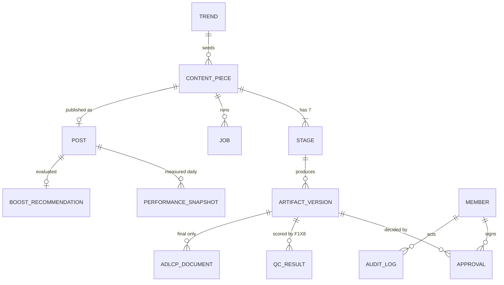

# MAISTRO — Target architecture (Phase 2)

Date: 2026-10-21 · Branch: `rebuild/phase-0-recon` · Inputs: `ARCHITECTURE_CURRENT.md`, `AUDIT.md` (approved by the owner on 2026-10-21), owner decisions: keep the "Dispatch to Hermes" path; roles defined in ADR-003 pending the owner's edits.

The target keeps every workflow users have today (trend intake, Hermes dispatch, external Hermes push, Studio generation with Higgsfield, real F1X8 QC and the fix-implementing final, Production Center approvals with ADLCP, performance from the tracker, reference photos) and makes each of them durable, attributable, observable and testable. The site at ma1stro.com stays up throughout: the new system is introduced behind the existing routes, page by page (ADR-009).

---

## 1. System shape

```mermaid
flowchart LR
  subgraph Client["Next.js app (React, TypeScript) — pages rendered per route"]
    T[Trends] --- S[Studio] --- PC[Production Center] --- C[Calendar] --- P[Performance] --- B[Boost]
  end
  subgraph Server["Next.js route handlers + server actions (TypeScript, zod-validated)"]
    AUTH[Auth + roles middleware]
    SVC[Domain services: Campaigns · Stages · Approvals · Jobs · Trends · Performance · Boost]
    AD[Adapters: KymahSource · CurationService · HiggsfieldClient · F1X8Client · HermesIngest · TrackerSource · PublishingAdapter · TranslationClient]
    AUTH --> SVC --> AD
  end
  subgraph Data["Maistro Supabase (Postgres + Storage), migrations in repo"]
    DB[(content_pieces · stages · artifact_versions · approvals · adlcp_documents · qc_results · jobs · trends_cache · posts · performance_snapshots · boost_recommendations · members · audit_log)]
    ST[(Storage: assets (private) · approvals (private) · refs (private))]
  end
  Client --> Server --> Data
  AD --> KY[Trend Radar agent API]
  AD --> AN[Anthropic]
  AD --> HF[Higgsfield]
  AD --> F1[F1X8 Modal]
  AD --> TR[(Tracker Supabase, read-only)]
  AD -. manual/export mode until access .-> SP[Sprinklr]
  EXT[External Hermes agent] --> Server
  CRON((Vercel cron: trends refresh · jobs tick · daily performance snapshot · stale checks)) --> Server
```

**Principles** (from the audit): server-side truth for every state; every write validated at the boundary and idempotent; every external call behind an adapter with timeout, retry and recorded request ids; no integration faked — an unavailable one is shown as such; one business timezone; auto-escaped rendering; structured logs keyed by content piece.

## 2. Frontend

**Framework: Next.js 15 (App Router) + React 19 + TypeScript**, deployed on Vercel (ADR-001). Styling: CSS modules with the existing design tokens (black/silver surface, gold accent, Unbounded headline font) carried over from `index.html` so the product looks the same on day one. No UI kit lock-in; a small internal component library (`components/ui`) built as pages migrate.

Pages (each replaces one hash route; see ADR-009 for how both coexist):

| Route (new) | Replaces | Server data | Client state |
|---|---|---|---|
| `/trends` | `#/trends` | `GET /api/trends` (cached feed with `fetchedAt`, `stale`) | filters only |
| `/studio/[pieceId]` | `#/studio` | content piece, stages, artifact versions, jobs, QC | form inputs, polling of job status via SWR |
| `/production` | Production Center section | pending deliverables across pieces, approvals | none |
| `/calendar` | `#/calendar` | posts, slots; publishing adapter mode | selection |
| `/performance` | `#/performance` | server-merged performance (track + snapshot), timezone-anchored buckets | filters |
| `/boost` | new | boost recommendations with rationale | none |
| `/` | landing | static | — |

Standards (applied to every page as it is built): loading / empty / error / stale / "integration not connected" states; `dir="auto"` on all user or model text and RTL-safe layout for Arabic; WCAG AA (focus order, contrast on the dark theme, labels, reduced motion); responsive down to 360 px; no `innerHTML` with interpolated data — React escapes by default; anything rich (model prose) goes through a sanitizer.

## 3. Domain model



Entities (columns abbreviated; full DDL in `db/migrations/` as they are built):

- **Trend** `trends_cache(id, source='trendradar', external_id, payload jsonb, fit_score, fetched_at, stale_after)` — the last-known-good feed; the UI never depends on a live scrape.
- **ContentPiece** `content_pieces(id uuid, title, product, key_message, angle, markets[], platforms[], trend_id, origin enum('hermes_dispatch','external_hermes','studio'), status enum('planning','in_production','in_review','approved','scheduled','published','archived'), created_by, created_at, updated_at)`.
- **Stage** `stages(id, piece_id, kind enum('plan','mood','thumb','brief','board','draft','qc','final'), position smallint, state enum('locked','ready','generating','generated','rejected','approved'), current_version_id, updated_at)` — one row per stage per piece, created with the piece.
- **ArtifactVersion** `artifact_versions(id, stage_id, version int, kind enum('text','image','video','qc_report'), payload jsonb (text artifacts: brief/plan/qc; media: {asset_id, prompt, note, director_note}), produced_by enum('claude','higgsfield_soul','higgsfield_seedance','f1x8','external_hermes'), job_id, created_at)` — append-only; `(stage_id, version)` unique.
- **Approval** `approvals(id, artifact_version_id, decision enum('approved','rejected'), reason text, decided_by (member), decided_at, name_as_signed, role_as_signed)` — append-only; one open decision per version (partial unique index on approved).
- **ADLCPDocument** `adlcp_documents(id, artifact_version_id, kind enum('line_manager','adlcp'), storage_path, sha256, size, content_type, uploaded_by, uploaded_at)` — private bucket `approvals/<piece>/<version>/…`.
- **QCResult** `qc_results(id, artifact_version_id, job_id, provider='f1x8', score numeric, result jsonb (verdict, kpis, risks, revision_brief, percentile), heatmap_path (storage), created_at)`.
- **Job** `jobs(id, piece_id, stage_id, kind enum('director','higgsfield_image','higgsfield_video','f1x8_image','f1x8_video','hermes_stage','curation'), provider_ref (request_id/job_id), state enum('queued','running','succeeded','failed','timed_out','cancelled'), attempts, payload jsonb, result jsonb, error text, created_at, started_at, finished_at, next_poll_at)`.
- **Post** `posts(id, piece_id, platform, account, external_post_id, url, published_at, publishing_mode enum('sprinklr','manual_export'), permalink_recorded_by, …)`.
- **PerformanceSnapshot** `performance_snapshots(id, post_id, day date (Asia/Dubai), metrics jsonb, sentiment jsonb, comments_count, source enum('track','bridge'), captured_at)` — unique `(post_id, day)`; replaces the append-only `sentiment_posts`.
- **BoostRecommendation** `boost_recommendations(id, post_id, qualitative jsonb (f1x8 score + rationale), quantitative jsonb (kpi vs benchmark), verdict enum('boost','hold','no'), confidence numeric, rationale text, evaluated_at, benchmark_version)`.
- **Member / Role** `members(id = auth.users.id, email, display_name, role enum per ADR-003, active)`.
- **AuditLog** `audit_log(id, actor, action, entity, entity_id, before jsonb, after jsonb, at)` — written by a trigger on content_pieces/stages/approvals/adlcp_documents/posts.

### Stage state machine (explicit)

```mermaid
stateDiagram-v2
  [*] --> locked: piece created (all stages)
  locked --> ready: predecessor approved OR stage is 'plan' OR piece.origin=external_hermes
  ready --> generating: job queued (creator)
  generating --> generated: job succeeded → new artifact_version
  generating --> ready: job failed/timed out (error shown)
  generated --> approved: approval(approved) by reviewer; final additionally requires 2 adlcp_documents + role adlcp_approver
  generated --> rejected: approval(rejected, reason)
  rejected --> generating: regenerate (reason is the brief) → version+1
  approved --> ready: reopen (admin only, audited)
```



Rules enforced server-side (ADR-003/ADR-007): a stage can only be generated when `ready`; order is `plan → mood → thumb → brief → board → draft → qc → final` with `qc` requiring `draft` generated and `final` requiring `qc` approved; `final` cannot be approved without both ADLCP documents attached to **that version**; an approval row is immutable and bound to a version — regeneration creates a new version that starts unapproved; every transition is written to `audit_log`.

Hermes dispatch (kept, owner decision): origin `hermes_dispatch` runs the same stage machine automatically — a `hermes_stage` job per stage in order, each producing a version — and then stops at `draft` for the real F1X8 QC; the Claude-simulated QC stage is removed (ADR-007). External pushes (`external_hermes`) create versions directly via `/api/ingest` with idempotency keys and enter the review flow like any other.

## 4. Persistence

Maistro's own Supabase project (already exists; today holds `campaign_events`, `sentiment_posts`, bucket `refs`). Schema above, with: primary keys uuid; `created_at`/`updated_at` everywhere; FKs with `on delete restrict`; indexes on `(piece_id)`, `(stage_id, version)`, `(post_id, day)`, `(state, next_poll_at)` for jobs; RLS **on with policies** by role (ADR-003) so the anon key is never a bypass; service role used only by cron/jobs. Migrations as numbered SQL in `db/migrations/` applied by a small runner (the same pattern as the tracker's `scripts/run-sql.mjs`) in CI against a disposable database, then to preview, then to production. The tracker's Supabase stays external and read-only (adapter `TrackerSource`; its schema is a contract).

## 5. Integration adapters (`src/server/adapters/`)

Every adapter: typed input/output (zod), `AbortSignal.timeout`, bounded retries with jitter on 5xx/429, structured log line with `piece_id`, `job_id`, provider request id, latency, and cost where known; a `health()` probe for the status page; recorded fixtures for contract tests (Phase 3).

| Adapter | Target | Notes |
|---|---|---|
| `KymahSource` | Trend Radar agent API `GET /api/agent/trends` (bearer `AGENT_API_KEY`) | Read-only by construction (ADR-005). Hourly cron refresh into `trends_cache`; `stale` flag after 6 h; the page-scrape parser kept only as a documented fallback behind a flag. |
| `CurationService` | Anthropic (Claude Opus) | Versioned prompt files, explicit temperature, JSON-schema output validated server-side, token usage logged; eval set in Phase 6. |
| `HiggsfieldClient` | Soul v1/v2, Seedance | One job abstraction (`submit → provider_ref`, `status(provider_ref)`); finished assets copied into Storage `assets/` with sha256 (A-09). |
| `F1X8Client` | Modal FastAPI | Submit by URL (`video-url/submit`) or multipart from Storage only (allow-list; C-14); poll; persist full result + heatmap to Storage. Auth on the Modal app is a Phase 8 item in the F1X8 repo. |
| `HermesIngest` | inbound `/api/ingest` | Timing-safe bearer, per-stage zod schemas, `Idempotency-Key` (or derived `piece+stage+version`), size cap, creates artifact versions. Contract in `API.md` kept backward compatible. |
| `TrackerSource` | tracker Supabase (PostgREST) | The current `track.js` logic as a module: windowed reads, alias resolution, twin collapse; results materialised daily into `performance_snapshots` by cron; live read only on demand. |
| `PublishingAdapter` | Sprinklr (ADR-008) | Interface `schedule(post) / publish(post) / status(post)`; `SprinklrAdapter` implemented against the documented API but disabled until credentials exist; `ManualExportAdapter` active: exports the approved asset + caption + slot as a package and lets the operator record the permalink. UI shows "Sprinklr: not connected — manual mode". |
| `TranslationClient` | official translation API (Google Cloud Translate or DeepL) | Replaces the unofficial `gtx` endpoint; cached per text hash. |

## 6. Long-running jobs (ADR-004)

A `jobs` table is the source of truth. Submission writes a row and calls the provider; completion is detected by (1) provider webhooks where available (F1X8 is ours — add a callback; Higgsfield webhooks if offered on the account), (2) a **jobs tick** cron every minute that polls rows whose `next_poll_at` is due, and (3) an on-demand reconcile when a user opens a piece. The browser only *reads* job state (SWR every 5 s while a job is running) — it never owns it. Function timeouts are pinned per route (`maxDuration` in `vercel.json`); nothing in a request handler waits on a provider.

## 7. Auth and roles (ADR-003)

Supabase Auth (email magic link + Google), session cookie, `members.role`. Route handlers check `requireRole(...)`; RLS mirrors the same matrix. Proposed roles: `admin` (everything, reopen approved work), `creator` (create pieces, generate, regenerate, upload refs), `reviewer` (approve/reject non-final stages), `line_manager` (approve `final` with the LM document), `adlcp_approver` (approve `final` with the ADLCP document), `viewer` (read-only incl. performance). The external Hermes agent is a `service` principal with the ingest key only.

## 8. Asset storage

Supabase Storage, three private buckets with signed URLs (1 h): `assets/<piece>/<stage>/<version>.<ext>` for copied generated media; `approvals/<piece>/<version>/<kind>.<ext>` for ADLCP/LM documents (sha256 recorded, immutable); `refs/<piece>/<id>.jpg` for reference photos (today's public bucket migrated). Retention: assets kept with the piece; nothing deleted without an admin action and an audit row.

## 9. Caching, config, secrets

- Trend feed: DB cache + hourly cron; edge `s-maxage=300` on the public GET.
- Performance: daily materialised snapshot; live tracker read behind a "refresh now" button, rate-limited.
- Config: one `config.ts` that parses `process.env` with zod at boot and fails fast; names documented in `.env.example`; no defaults for secrets, no hard-coded provider URLs.
- Secrets: Vercel project env per environment (development / preview / production); rotated keys for everything pasted in chat during the prototype (D-05); `CRON_SECRET` verified on every cron route.
- Timezone: `Asia/Dubai` constant on the server for every day bucket and label; ISO timestamps on the wire.

## 10. Folder structure

```
maistro/
├─ app/                      Next.js App Router: (marketing)/ , (app)/trends, studio/[pieceId], production, calendar, performance, boost, api/*
├─ src/
│  ├─ domain/                entities, state machine (pure, unit-tested), zod schemas
│  ├─ server/
│  │  ├─ services/           campaigns, stages, approvals, jobs, trends, performance, boost
│  │  ├─ adapters/           kymah, curation, higgsfield, f1x8, hermes-ingest, tracker, publishing (sprinklr, manual), translation
│  │  ├─ db/                 query layer (typed), migrations runner
│  │  ├─ auth/               session, roles, requireRole
│  │  └─ log/                structured logger, correlation ids
│  └─ ui/                    components (tokens, primitives, stage boxes, review cards, kpi tiles)
├─ db/migrations/            numbered SQL
├─ prompts/                  versioned prompt files + schemas (curation, hermes stages, director)
├─ tests/                    unit (domain), integration (services w/ test db), contract (recorded fixtures), e2e (Playwright, preview)
├─ docs/adr/                 decisions
└─ legacy/                   demo-ui (served until each page is replaced), then removed
```

## 11. Observability and operations

Structured JSON logs (request id, member, piece id, job id, adapter, latency, cost); an error tracker (Sentry) on client and server; `/api/health` aggregating adapter probes (kymah feed age, tracker snapshot age, Higgsfield/Modal reachability, DB); alerts (Vercel cron failures, health probe failures, trend feed stale > 6 h, performance snapshot stale > 36 h, job stuck > 30 min); `RUNBOOK.md` for each.

## 12. What is explicitly not built

Lenceus, LangGraph and the legacy `services/` engine (owner decision; archived in milestone M1 after confirmation). Any "connected" claim for Sprinklr before credentials exist. Any synthetic human sign-off.
