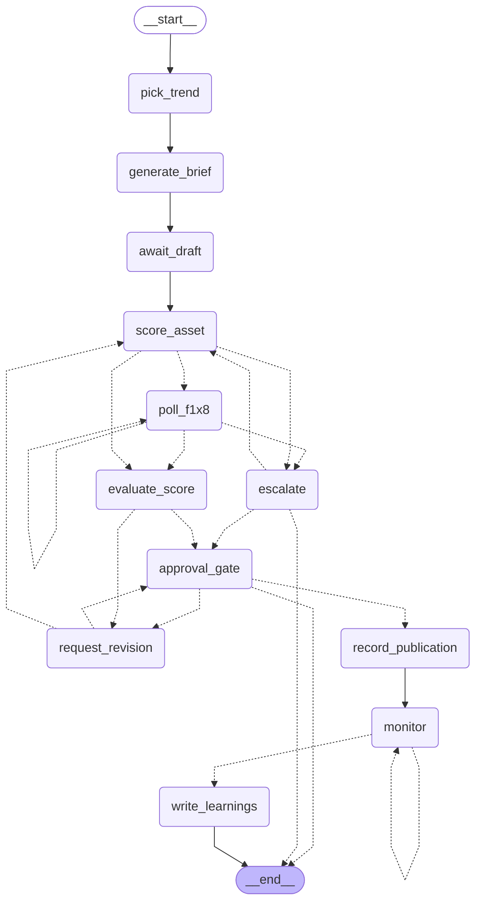

# Campaign graph — compiled topology

**Generated by `services/core/scripts/draw_graph.py` — do not edit by hand.**
Regenerate after any change to `graph/builder.py`.

Interrupt (pause) points: `await_draft`, `request_revision`,
`approval_gate`, `record_publication`, `monitor` (tick loop), `escalate`.
Each is resumed by an MCP tool call (creator), a REST call
(approver/operator), or the daily scheduler (monitor).

